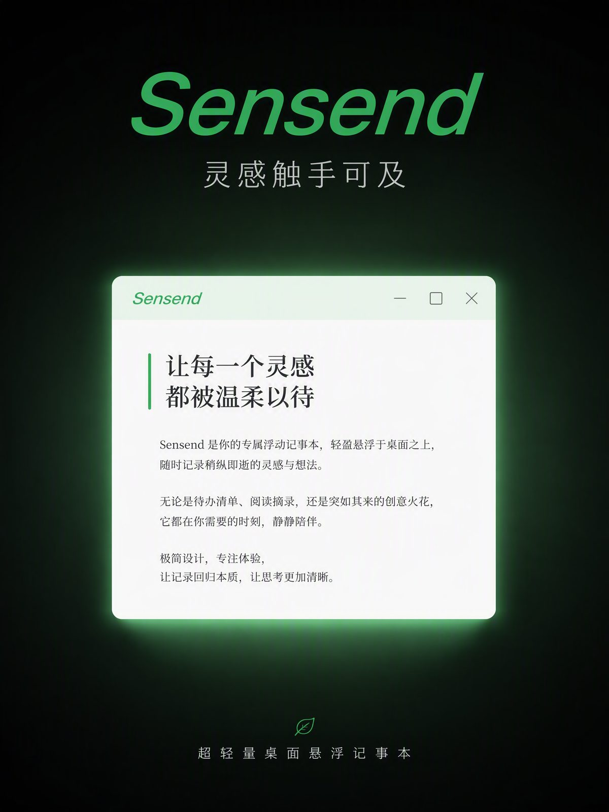
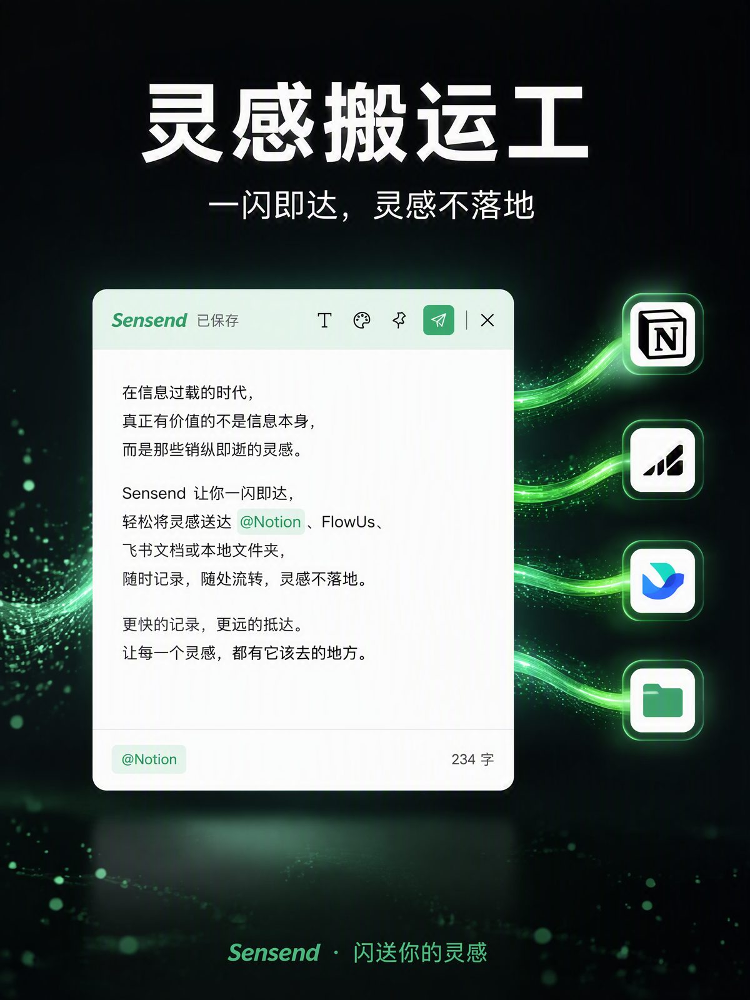
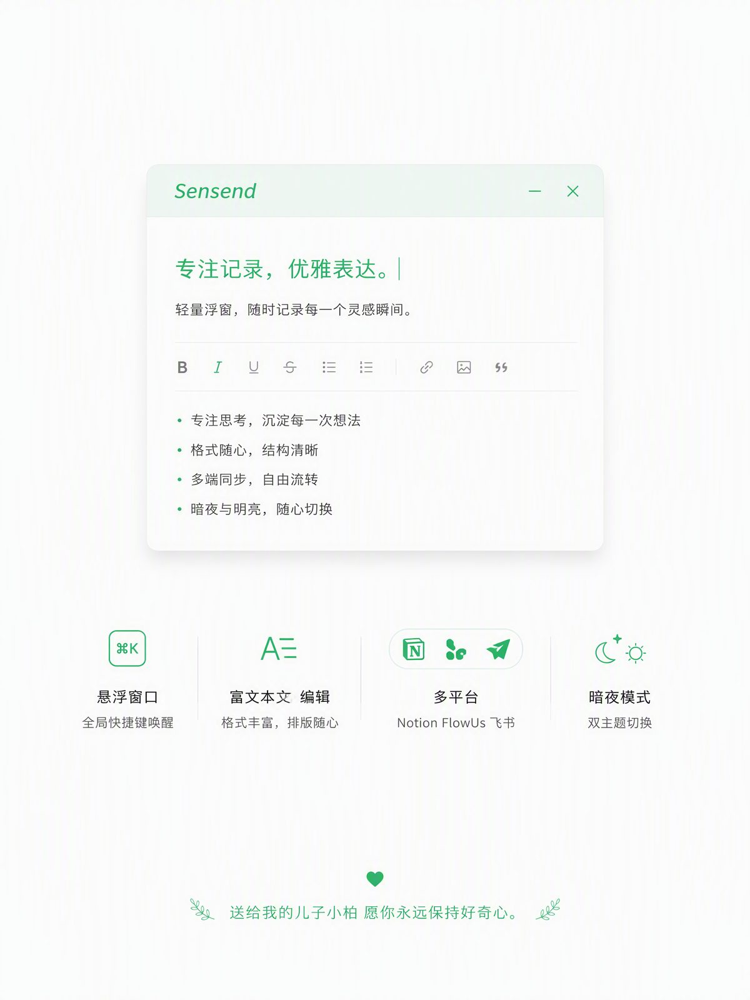

<p align="center">
  
</p>

<h1 align="center">Sensend</h1>

<p align="center">
  超轻量桌面悬浮记事本 · 一键唤醒，灵感即达
</p>

<p align="center">
  <a href="https://github.com/jloft198479-cyber/sensend/releases">⬇ 下载</a> ·
  <a href="#快速开始">快速开始</a> ·
  <a href="docs/BUILD-GUIDE.md">构建指南</a> ·
  <a href="docs/adapter-development-guide.md">适配器开发</a>
</p>

---

灵感稍纵即逝，切换应用的那一刻它就溜了。

Sensend 悬浮于桌面之上，`Alt+Shift+F` 一键唤醒，写完 `Ctrl+Enter` 直接发送到 Notion / FlowUs / 飞书 / 本地文件夹。不切窗口、不开浏览器、不打断心流。

从想法到落地，只需要三秒钟。

## 为什么是 Sensend

<p align="center">
  
</p>

- **悬浮即写** — 窗口浮在所有应用之上，全局快捷键唤醒，无需切换工作流
- **富文本编辑** — 标题、列表、引用、代码块、待办清单、下划线，所见即所得
- **一闪即达** — `@Notion` / `@FlowUs` / `@飞书` 提及即发送，格式保真，表格 / 代码块 / 嵌套列表完整保留
- **七主题切换** — 浅色 5 套（草绿 / 天青 / 魅蓝 / 墨白 / 秋珀）+ 深色 2 套（夜山 / 暗夜），顶栏一键切换，双窗口实时同步
- **极简省内存** — 隐藏 10 秒自动瘦身，把闲置内存还给系统；唤起首下不卡顿
- **自动保存** — 输入即存，退出前等待在途写入，不丢最后一个字

## 快速开始

1. **下载安装** — 前往 [Releases](https://github.com/jloft198479-cyber/sensend/releases) 获取最新版本
2. **配置平台** — 首次启动，点击「配置页面」，填入 Notion / FlowUs / 飞书的授权信息
3. **开始记录** — `Alt+Shift+F` 唤醒窗口，输入内容
4. **一键发送** — `@` 提及目标平台，`Ctrl+Enter` 发送

## 支持的平台

| 平台 | 创建子页面 | 追加内容 | 说明 |
|------|:---------:|:-------:|------|
| Notion | ✅ | ✅ | 支持 Database |
| FlowUs | ✅ | ✅ | 支持多维表 |
| 飞书 | ❌ | ✅ | 追加到已有文档 |
| 本地 | ✅ | ❌ | 创建 .md 文件 |

> 格式保真：表格单元格多 rich_text 完整保留、代码块语言智能映射（40+ 别名）、嵌套列表深度截断不丢失。

## 快捷键

| 快捷键 | 功能 |
|--------|------|
| `Alt+Shift+F` | 全局唤醒窗口（可自定义） |
| `Ctrl+Enter` | 发送内容（可自定义） |
| `Esc` | 隐藏窗口 |

## 设计理念

<p align="center">
  
</p>

没有标签树、没有分类系统、没有云同步的焦虑。

Sensend 只做一件事：**在你需要的时刻，接住那个想法，然后送它去该去的地方。**

极简设计，专注体验。让记录回归本质，让思考更加清晰。

## 版本更新

### v0.5.2 — 界面体系落地 + 主题重调

- **七套主题**：墨白、秋珀重新调校（文字层次拉开、暖纸配冷墨）；新增**天青**（浅）与**夜山**（深），菜单按浅色/深色分组
- **设计系统**：40 个语义 token 覆盖全部七套主题，颜色与间距不再散落硬编码；新增两道门禁脚本（token 字面量 / 对比度），不达标直接拦构建
- **管理页提速**：打开不再白闪、不再有假空态；关掉后再开是瞬开（不再重新解析编辑器主包）
- **@ 列表**：当前目标置顶并标注、搜索命中高亮、键鼠共用同一套高亮；修复「搜"飞书"搜不到」等三处 bug
- **发送修复**：FlowUs 表格单元格多段文本、待办、嵌套列表三处丢失（第三方评审 48 条的修复批次）
- **工程**：新增一键热更新开发入口（改样式秒生效，不必重编译）；构建与发布文档全量校正；自动更新三件套（安装包 / 签名 / 清单）齐传

### v0.5.0 — 内存优化

- **隐藏即瘦身**：窗口隐藏 10 秒后自动修剪进程树工作集，闲置内存还给系统
- **启动省内存**：WebView2 关闭 GPU 进程（省 40~60MB）、V8 堆封顶 96MB
- **构建加固**：修复自定义编译环境下 PATH 大小写覆盖导致 MSVC 失败
- **文档整理**：docs/ 单一入口，新增索引 / 升级记录 / 适配器开发规范

### v0.4.0 — 主题 + 格式保真

- **四主题**：草绿 / 暗夜 / 秋珀 / 魅蓝，组件化 CSS，新增主题只需两步
- **格式保真**：Notion / FlowUs 表格完整保留、飞书原生表格、代码块语言映射（40~43 个别名）
- **体验**：发送成功标记、一键清理 + 撤销、note.json 迁移、并发守卫

### v0.3.0 — 基础加固

- 默认发送目标迁移到后端 config.json
- 适配器健壮性提升、打包脚本新增

### v0.2.0 — 格式扩展

- 新增待办清单、下划线，四平台同步支持
- 飞书令牌缓存、Notion 目标解析并行化

## 开发

```bash
npm install          # 安装依赖
```

**日常开发（改样式 / 调交互）**：双击仓库根目录的 `启动开发模式.bat`，或：

```bash
powershell -NoProfile -ExecutionPolicy Bypass -File scripts\run-dev.ps1
```

走 vite 热更新——改 CSS / 组件**秒看到，不用重新编译**。

> ⚠️ 本机 Rust 与 VS Build Tools 不在系统 PATH，**别裸跑 `npm run tauri dev` / `npm run tauri build`**，会报"找不到 cargo / cl.exe"。
> 打包发布：`powershell -NoProfile -ExecutionPolicy Bypass -File "scripts\build-release.ps1"`
> 完整路径说明见 [docs/BUILD-GUIDE.md](docs/BUILD-GUIDE.md)。

### 技术栈

- **前端**：Vue 3 + TipTap + TypeScript + Vite
- **后端**：Rust + Tauri 2
- **平台 API**：Notion API / FlowUs API / 飞书开放平台

## 致谢

这款工具送给我的儿子 **小柏**，愿你永远保持好奇心。

## 作者

**简乐** ([@jloft198479-cyber](https://github.com/jloft198479-cyber)) · jloft198479@gmail.com

## 许可证

[MIT License](LICENSE) · Copyright (c) 2026 简乐
